# CityCare Medical Centre: Clinic Appointment & Patient Management System

A Laravel 12 web application for **CityCare Medical Centre, Kampala (Uganda)** that replaces the
clinic's notebooks, spreadsheets and WhatsApp messages with one central system. It handles patient registration, doctor schedules,
appointment booking without double-booking, consultation and treatment records, billing,
and management reporting.

   

---

## Screenshots

The key screens, each tied to a clinic requirement. **[All 15 desktop and 5 mobile screens, with the requirement each one shows →](screenshots/README.md)** · A slide deck of them is in [`presentation/`](presentation/).

<table>
  <tr>
    <td width="50%"><a href="screenshots/desktop/03-admin-dashboard.png">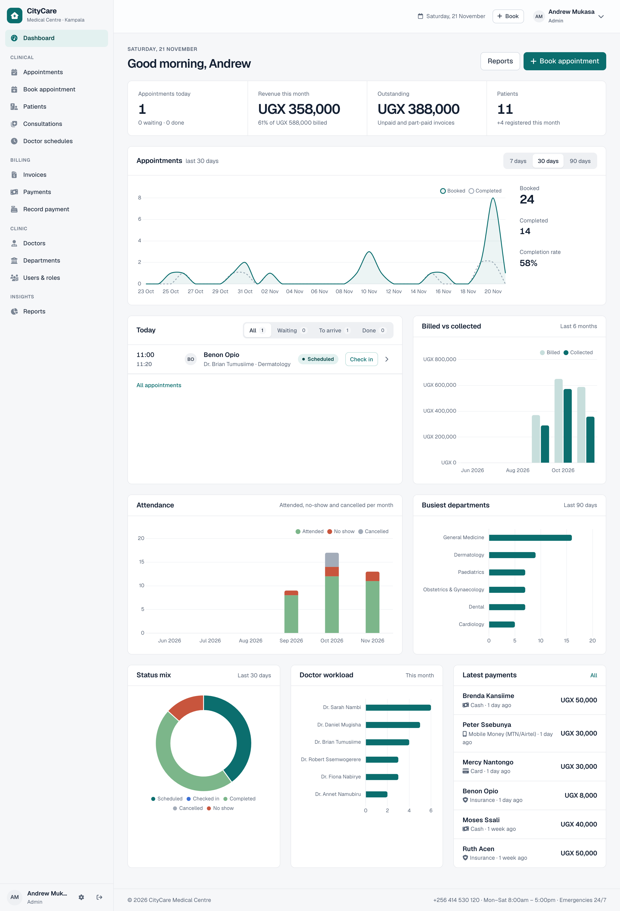</a><br><sub><b>Admin dashboard</b>: management overview: appointments, revenue, attendance</sub></td>
    <td width="50%"><a href="screenshots/desktop/05-front-desk-dashboard.png">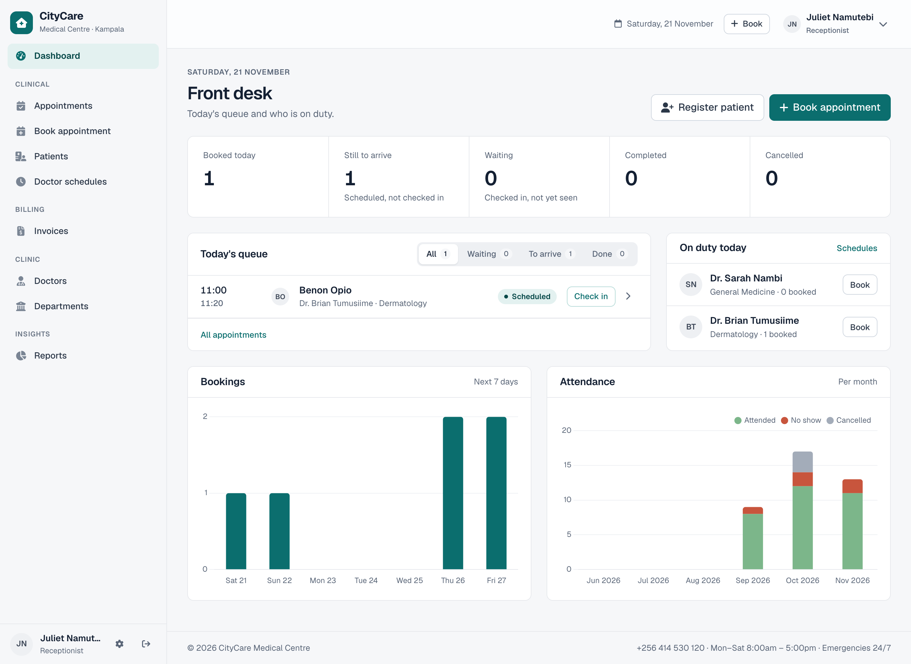</a><br><sub><b>Front desk</b>: today's queue with one-click check-in</sub></td>
  </tr>
  <tr>
    <td width="50%"><a href="screenshots/desktop/06-book-appointment-no-double-booking.png">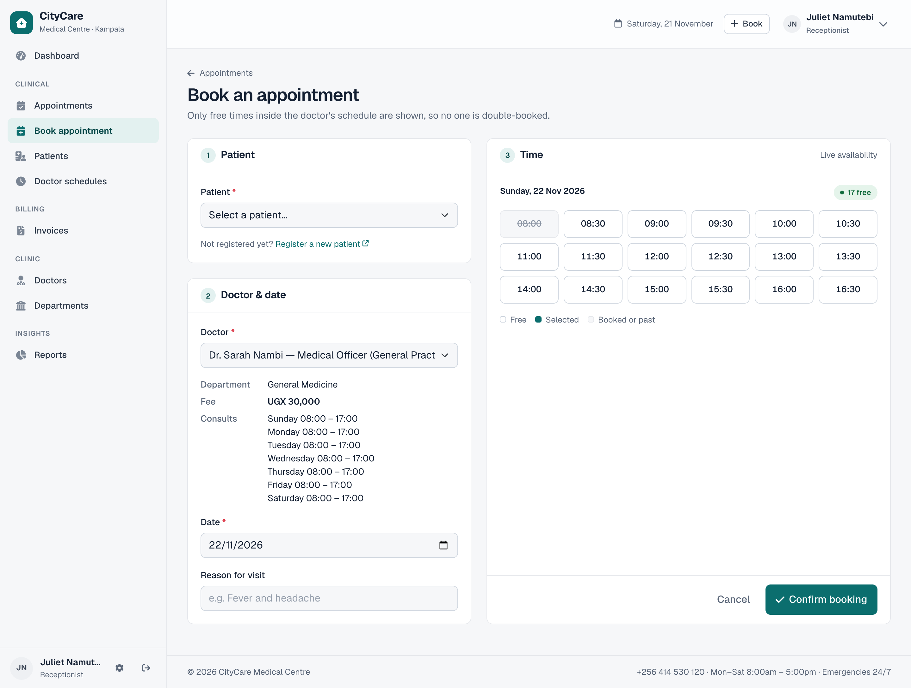</a><br><sub><b>Book appointment</b>: booked slots are struck through, so no double-booking</sub></td>
    <td width="50%"><a href="screenshots/desktop/08-register-patient-duplicate-warning.png">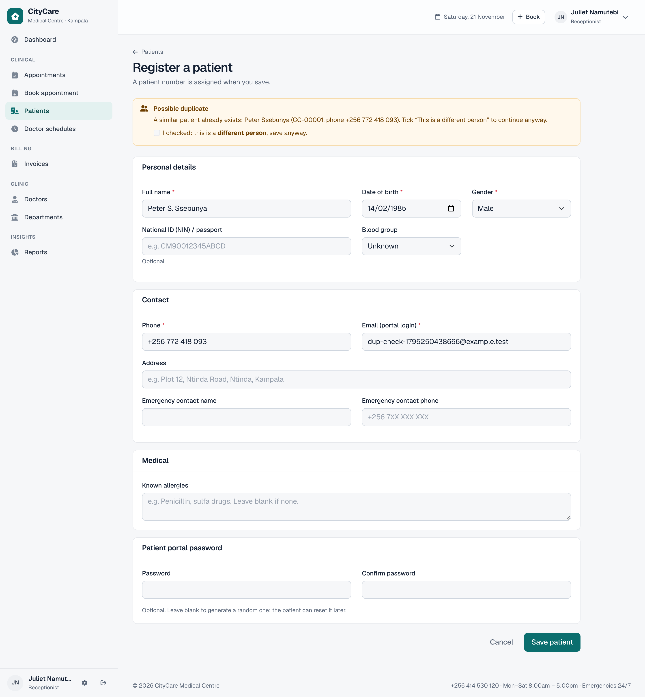</a><br><sub><b>Register patient</b>: a matching phone or name + birth date is flagged as a duplicate</sub></td>
  </tr>
  <tr>
    <td width="50%"><a href="screenshots/desktop/09-patient-record-treatment-history.png">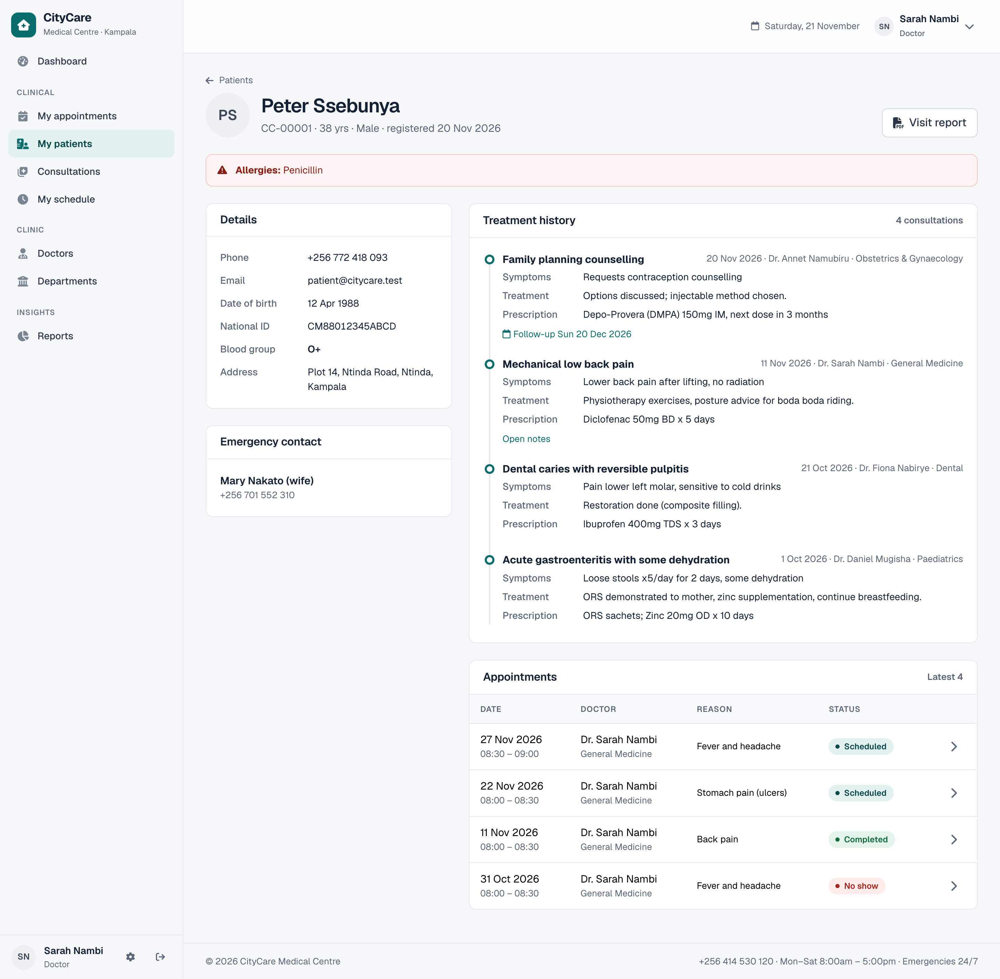</a><br><sub><b>Patient record</b>: treatment timeline and allergies for the doctor</sub></td>
    <td width="50%"><a href="screenshots/desktop/11-consultation-notes.png">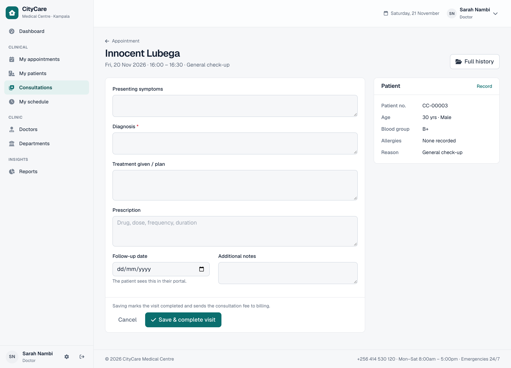</a><br><sub><b>Consultation notes</b>: saving completes the visit and raises the invoice</sub></td>
  </tr>
  <tr>
    <td width="50%"><a href="screenshots/desktop/13-cash-desk-dashboard.png">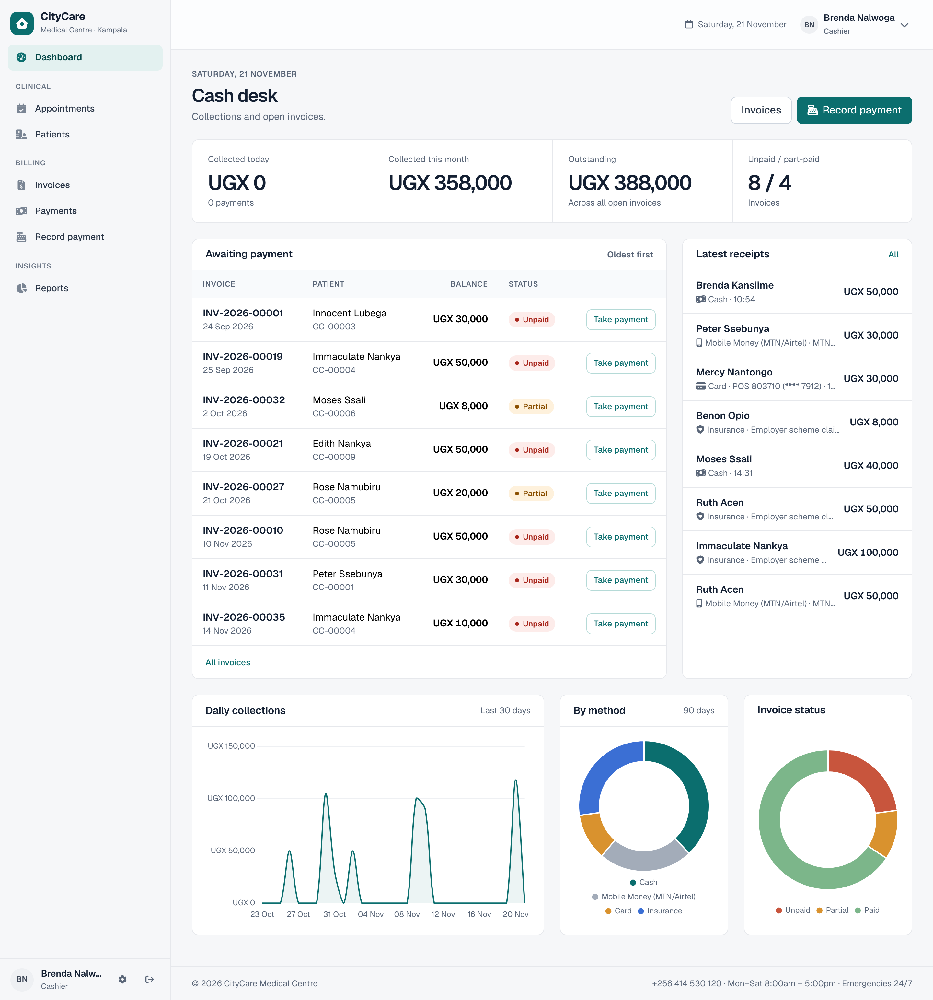</a><br><sub><b>Cash desk</b>: who has paid and what is outstanding</sub></td>
    <td width="50%"><a href="screenshots/desktop/14-invoice-and-payment.png">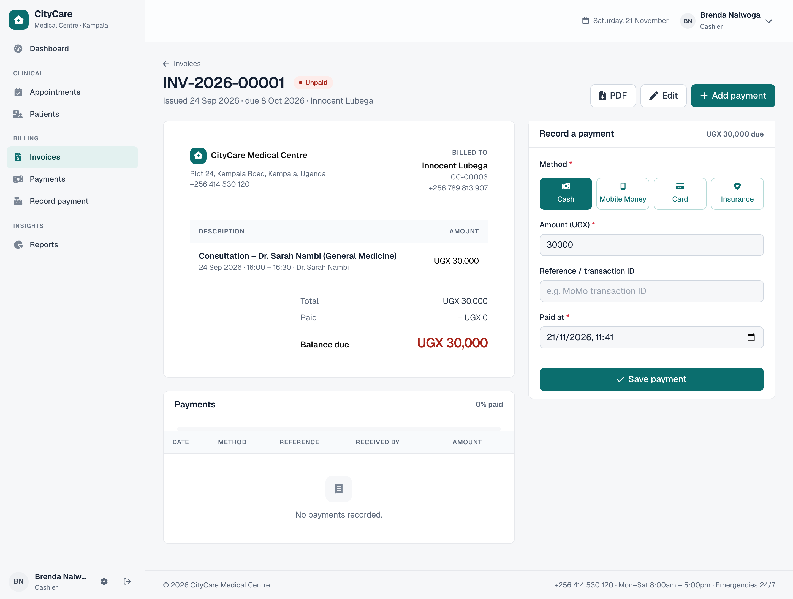</a><br><sub><b>Invoice</b>: pay by cash, Mobile Money, card or insurance</sub></td>
  </tr>
</table>

<p>
  <a href="screenshots/mobile/01-home-page.png"></a>
  <a href="screenshots/mobile/02-log-in.png">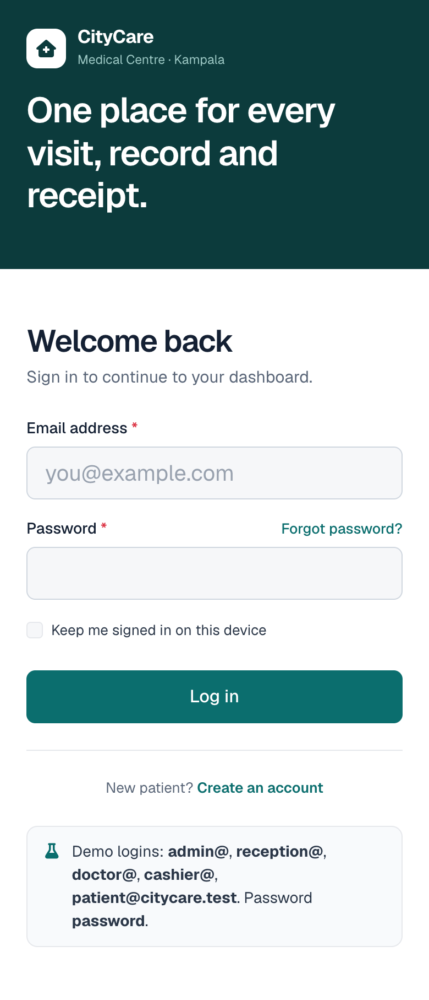</a>
  <a href="screenshots/mobile/03-front-desk-dashboard.png">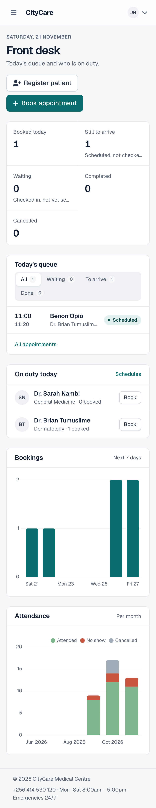</a>
  <a href="screenshots/mobile/04-book-appointment.png">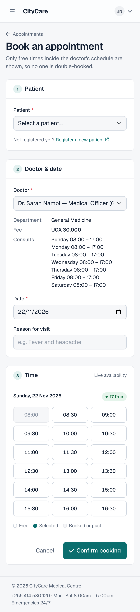</a>
  <a href="screenshots/mobile/05-patient-portal.png">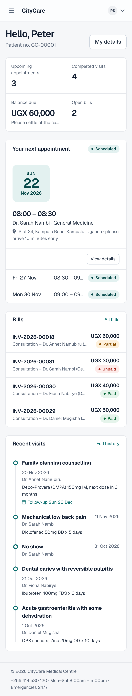</a>
  <br><sub>On a phone: home page, log in, front desk, booking and the patient portal.</sub>
</p>

---

## Contents

0. [Screenshots](#screenshots)
1. [How the system solves the clinic's problems](#1-how-the-system-solves-the-clinics-problems)
2. [Tech stack](#2-tech-stack)
3. [Installation](#3-installation)
4. [Demo accounts (seeded users)](#4-demo-accounts-seeded-users)
5. [What each role can access](#5-what-each-role-can-access)
6. [Features by module](#6-features-by-module)
7. [AJAX / API features](#7-ajax--api-features)
8. [Reports (PDF / Excel / CSV)](#8-reports-pdf--excel--csv)
9. [Database design](#9-database-design)
10. [Seed data](#10-seed-data)
11. [Project structure](#11-project-structure)
12. [Troubleshooting](#12-troubleshooting)

---

## 1. How the system solves the clinic's problems

| Problem at CityCare | How the system fixes it |
|---|---|
| Receptionists double-book doctors | Every booking goes through `AppointmentService`. It only accepts a slot inside the doctor's weekly schedule that doesn't overlap another active appointment. It locks the doctor row in a DB transaction, so two simultaneous bookings can't both win. The booking form only shows free slots (AJAX). |
| Long waiting times / poor coordination | The reception dashboard shows today's queue, who is checked in, and which doctors are on duty. |
| Duplicated patient records | Each patient gets a unique patient number (`CC-00001`). National ID and email are unique, and registration warns when the name + date of birth or the phone number already exist. |
| Doctors can't see previous visits | The patient record has a treatment-history timeline (diagnosis, treatment, prescription, follow-up). The doctor reaches it in one click from their schedule. |
| Cashiers can't tell who has paid | Completing a visit automatically raises an invoice at the doctor's fee (in UGX). Payments (cash, MTN/Airtel Mobile Money, card, insurance) update the invoice status (unpaid → partial → paid). |
| No management overview | The role dashboards have charts for appointment trends, department load, doctor workload, revenue, attendance (attended / no-show / cancelled) and payment methods. Reports export to PDF, Excel and CSV. |

## 2. Tech stack

| Concern | Choice |
|---|---|
| Framework | Laravel 12 (PHP 8.2+) |
| Database | MySQL / MariaDB (XAMPP) |
| Authentication | Laravel Breeze (Blade), restyled with Bootstrap |
| Authorization | `role` column + `role:` middleware + Policies (`app/Policies`) |
| UI | Bootstrap 5.3, Font Awesome 6, Chart.js 4 (bundled with Vite) |
| PDF | `barryvdh/laravel-dompdf` |
| Excel / CSV | `maatwebsite/excel` |
| AJAX | Axios → session-authenticated JSON routes under `/ajax/*` |

## 3. Installation

### Requirements
- PHP 8.2+ with the `pdo_mysql`, `gd`, `zip`, `mbstring` and `fileinfo` extensions (XAMPP has them)
- Composer 2
- Node.js 18+ and npm
- MySQL 8 or MariaDB 10.4+ (XAMPP's MySQL is fine)

### Quick setup (one command)

With MySQL running (XAMPP Control Panel → Start MySQL), run:

```bash
php setup.php
```

It checks PHP, its extensions, Composer and npm. Then it installs the Composer packages, creates
`.env` and the app key, and creates the `citycare` database if it doesn't exist. After that it
runs the migrations, seeds the demo data (only when the database is empty), links storage, builds
the front-end assets and clears the caches. It is safe to run again.

| Option | Effect |
|---|---|
| `php setup.php --fresh` | Drop all tables, re-migrate and re-seed (resets the demo data to today) |
| `php setup.php --no-assets` | Skip `npm install` / `npm run build` |

`composer setup` runs the same script. To run each step yourself instead, follow the manual
steps below.

### Manual steps

```bash
# 1. Install dependencies
composer install
npm install

# 2. Environment
cp .env.example .env
php artisan key:generate
```

Edit `.env` if your database login differs (the defaults match XAMPP):

```dotenv
DB_CONNECTION=mysql
DB_HOST=127.0.0.1
DB_PORT=3306
DB_DATABASE=citycare
DB_USERNAME=root
DB_PASSWORD=

CLINIC_CURRENCY=UGX           # Uganda Shillings, shown without decimals (e.g. "UGX 30,000")
APP_TIMEZONE=Africa/Kampala   # East Africa Time (UTC+3)
```

```bash
# 3. Create the database (or create "citycare" in phpMyAdmin)
mysql -uroot -e "CREATE DATABASE IF NOT EXISTS citycare CHARACTER SET utf8mb4 COLLATE utf8mb4_unicode_ci"

# 4. Tables + demo data (takes a few seconds)
php artisan migrate:fresh --seed

# 5. Public link for profile photos
php artisan storage:link

# 6. Build front-end assets
npm run build          # or `npm run dev` while editing CSS/JS

# 7. Run
php artisan serve      # http://127.0.0.1:8000
```

> **Faster local server (recommended on XAMPP).** XAMPP's PHP ships with OPcache disabled,
> which makes every request take 3–5 seconds. Either run
> `composer serve-fast` (it starts PHP's built-in server on http://127.0.0.1:8000 with OPcache
> turned on), or enable it permanently in `/Applications/XAMPP/xamppfiles/etc/php.ini`:
> ```ini
> zend_extension=opcache.so
> opcache.enable=1
> opcache.enable_cli=1
> ```

The seed data is generated relative to **today's date**. Re-run `php artisan migrate:fresh --seed`
whenever you want "today" on the dashboards to be full again.

### Mobile Money payments (MTN / Airtel via Flutterwave)

Cashiers can send a payment request to the patient's phone from any unpaid invoice, and patients can pay their own bills from the portal (**Pay**). The patient approves with their Mobile Money PIN; the invoice updates by itself once Flutterwave confirms the payment.

**Demo mode (default, no keys needed).** With `MOBILE_MONEY_DRIVER=fake`, no money moves: requests are approved after a few seconds, and numbers ending in `000` are declined, so you can show both outcomes.

**Flutterwave sandbox / live.** Create a Flutterwave account, then in `.env`:

```dotenv
MOBILE_MONEY_DRIVER=flutterwave
FLW_SECRET_KEY=FLWSECK_TEST-xxxxxxxxxxxx   # Settings → API keys (test keys for the sandbox)
FLW_SECRET_HASH=any-long-random-string     # Settings → Webhooks → Secret hash (same value)
FLW_BASE_URL=https://api.flutterwave.com/v3
```

Then set the webhook URL in the Flutterwave dashboard to `https://<your-domain>/webhooks/flutterwave` and run `php artisan config:clear`. Every webhook is checked against the secret hash and re-verified with the Flutterwave API before a payment is recorded; if no webhook arrives (for example on `localhost`), the invoice page checks the status itself every few seconds, and staff can press **Check now**.

## 4. Demo accounts (seeded users)

**Every account's password is `password`.** All people are fictional, and logins use the
reserved `.test` domain so no real mailbox is ever contacted.

| Role | Email | Name | Phone | Notes |
|---|---|---|---|---|
| Admin | `admin@citycare.test` | Andrew Mukasa | +256 772 530 101 | Full access |
| Receptionist | `reception@citycare.test` | Juliet Namutebi | +256 701 530 102 | |
| Receptionist | `reception2@citycare.test` | Ivan Kizza | +256 782 530 103 | |
| Doctor | `doctor@citycare.test` | Dr. Sarah Nambi | +256 772 530 201 | General Medicine. Consults **every day** 08:00–17:00, so "today" always has patients |
| Cashier | `cashier@citycare.test` | Brenda Nalwoga | +256 752 530 104 | |
| Cashier | `cashier2@citycare.test` | Edward Ssali | +256 776 530 105 | |
| Patient | `patient@citycare.test` | Peter Ssebunya (`CC-00001`) | +256 772 418 093 | Ntinda, Kampala. Has past visits, a no-show, an **unpaid** invoice and 2 upcoming appointments |
| *(inactive)* | `inactive@citycare.test` | Agnes Namata | +256 704 530 109 | Deactivated, so login is refused (demonstrates account deactivation) |

**The other 5 doctors** (one per department) can log in too (password `password`). Registration
numbers use a `UMDPC/xxxxx` (Uganda Medical & Dental Practitioners Council) format, and fees are in UGX:

| Doctor | Email | Department | Fee | Schedule |
|---|---|---|---|---|
| Dr. Daniel Mugisha | `daniel.mugisha@citycare.test` | Paediatrics | 50,000 | Mon–Fri 08:00–12:30, 14:00–17:00 |
| Dr. Robert Ssemwogerere | `robert.ssemwogerere@citycare.test` | Cardiology | 100,000 | Mon, Wed, Fri 09:00–17:00 (45-min slots) |
| Dr. Annet Namubiru | `annet.namubiru@citycare.test` | Obstetrics & Gynaecology | 60,000 | Mon–Fri 08:00–12:30, 14:00–17:00 |
| Dr. Brian Tumusiime | `brian.tumusiime@citycare.test` | Dermatology | 50,000 | Mon–Fri 08:00–13:00, Sat 09:00–12:00 (20-min) |
| Dr. Fiona Nabirye | `fiona.nabirye@citycare.test` | Dental | 40,000 | Mon–Fri 08:00–12:30, 14:00–17:00 |

The other 9 patients are generated with Ugandan names from across the regions (e.g. *Innocent
Lubega*, *Brenda Kansiime*, *Edith Nankya*), MTN/Airtel numbers (`+256 77x/78x/70x/75x …`),
NIN-style national IDs (`CF97…`, 14 characters), and addresses around Kampala and Wakiso (Ntinda,
Kololo, Muyenga, Najjera, Entebbe …). Their emails are `firstname.surname123@example.com`. New
patients can also self-register at `/register`.

## 5. What each role can access

Each user sees only the sidebar items for their role. Direct URLs are blocked by the
`role:` middleware (HTTP 403) and record ownership is enforced by Policies.

| Feature | Admin | Receptionist | Doctor | Cashier | Patient |
|---|:-:|:-:|:-:|:-:|:-:|
| Role-specific dashboard with charts | ✅ | ✅ | ✅ | ✅ | ✅ (no charts) |
| Own profile + photo upload + password | ✅ | ✅ | ✅ | ✅ | ✅ (+ medical/contact details) |
| **Users & roles** (create staff, activate/deactivate) | CRUD | – | – | – | – |
| **Departments** | CRUD | view | view | – | – |
| **Doctors** | CRUD | view | view | – | view ("Our Doctors") |
| **Consultation schedules** | CRUD | view | view own | – | – |
| **Patients** | CRUD | create / edit / view | view *own* patients | view | own record only |
| **Appointments** | CRUD, cancel, status | book / reschedule / cancel / check in | view *own*, check in, no-show | view | view *own* |
| **Consultation notes** (diagnosis, treatment, prescription) | view, delete | – | create / edit *own* | – | view *own* (visit history) |
| **Invoices** | CRUD | view | – | CRUD | view *own* + PDF |
| **Payments** | CRUD | – | – | CRUD | sees them on own invoices |
| **Reports** | all 4 | daily list, doctor schedule, patient visits | own schedule, own patients' visits | payment report | – |

### Typical walkthrough
1. **Receptionist** → *Book Appointment* → choose the patient from the list → pick a doctor and date → only free slots are clickable → *Confirm booking*.
2. **Doctor** → dashboard *Today's patients* → **Consult** → write diagnosis, treatment and prescription → saving marks the visit completed and raises the invoice.
3. **Cashier** → dashboard *Oldest open invoices* → **Pay** → record cash or mobile money → the invoice becomes *Paid* or *Partial*.
4. **Patient** → dashboard shows upcoming appointments, visit history and outstanding balance, and they can download invoice PDFs.
5. **Admin** → *Reports* → payment report for this month → PDF / Excel / CSV.

## 6. Features by module

To keep the system simple and fast, every list page shows **the latest 10 records**
(`config/clinic.php` → `per_page`). There is no pagination, filtering or search, and the full
history of a patient is on their record page.

| Module | Highlights |
|---|---|
| Users | Create staff accounts, activate/deactivate, can't delete or deactivate yourself; inactive users are refused at login and logged out mid-session |
| Departments | Colourful card view, doctor and appointment counts, can't delete a department that still has doctors |
| Doctors | Creates the login account and profile together; optional default Mon–Fri schedule |
| Schedules | Overlapping blocks for the same doctor and day are rejected; slot length 10–60 min |
| Patients | Duplicate detection (name + date of birth, or phone), treatment timeline, billing summary, one-click visit report PDF |
| Appointments | Live slot picker (AJAX), reschedule, cancel with reason, check-in, no-show, completed |
| Consultations | Saving completes the visit and auto-invoices it |
| Invoices | Totals (billed / paid / outstanding), PDF invoice, manual charges (lab tests etc.) |
| Payments | Overpayment is blocked, invoice totals recalculate on create/edit/delete |

### Colourful design
- Purple gradient sidebar with **multi-coloured icons**; the active page is highlighted in red→orange.
- **Gradient stat cards** (blue, teal, orange, green, red, purple) on every dashboard.
- **Colour-coded buttons:**

  | Colour | Used for |
  |---|---|
  | 🟢 Green | Create, book, save, log in |
  | 🔴 Red | Register, delete, cancel, PDF |
  | 🟠 Orange | Edit |
  | 🔵 Cyan | View |
  | 🟣 Purple | Reports |
  | ⚪ Grey | Back |

- Purple gradient table headers, coloured top borders on chart cards, colourful department tiles, and a
  vivid Chart.js palette.

### Public welcome page
The landing page (`/`) has a full-screen photo background (`public/images/welcome-bg.jpg`, a free
Unsplash photo) under a navy-to-blue gradient. It shows a Uganda flag stripe, the clinic's Kampala
address, phone numbers and opening hours, and Log in / Register buttons. The login and registration
pages reuse the same photo behind the form.

## 7. AJAX / API features

The brief asks for *"at least one API or AJAX-based feature to improve user experience"*. The system
has **two**, both built the same way:

```
Browser (Blade page)                         Laravel
─────────────────────                        ───────────────────────────────────────────
user picks / types something
   │  JavaScript (resources/js/*.js)
   │  window.axios.get('/ajax/…')  ───────►  routes/web.php  → middleware: auth + role:…
   │  (X-Requested-With: XMLHttpRequest,         │
   │   session cookie, no page reload)           ▼
   │                                          Controller returns response()->json([...])
   ◄──────────────── JSON ────────────────────────┘
   │
updates only part of the page (slot grid, chart)
```

- All endpoints live under the **`/ajax` prefix** in [`routes/web.php`](routes/web.php) (route names `ajax.*`).
- They use the **normal login session**, so no API tokens are needed. They are protected by the same `auth` and `role:` middleware as the pages. A user without the right role gets **HTTP 403**, and a logged-out user is redirected to login.
- Axios is set up in [`resources/js/bootstrap.js`](resources/js/bootstrap.js) and loaded once by [`resources/js/app.js`](resources/js/app.js), which starts both features on page load.

### Summary

| # | Feature | Endpoint | Where in the UI | Roles allowed |
|---|---|---|---|---|
| 1 | Dynamic slot loading / real-time doctor availability | `GET /ajax/doctors/{doctor}/slots?date=…` | **Book Appointment** and **Reschedule** forms | admin, receptionist (+ doctor, patient read-only) |
| 2 | Dashboard charts | `GET /ajax/dashboard/charts` | Admin, receptionist, doctor and cashier dashboards | all logged-in users (data depends on role) |

### 7.1 Dynamic appointment slots (real-time doctor availability)

**Problem it solves:** receptionists double-booking doctors.

**Where:** *Appointments → Book Appointment* (`/appointments/create`) and *Reschedule*
(`/appointments/{id}/edit`), in the card "3. Available time slots".

**How it works**
1. The receptionist chooses a **doctor** (dropdown grouped by department) and a **date**.
2. On every `change` of either field, [`slot-picker.js`](resources/js/slot-picker.js) calls
   `GET /ajax/doctors/{id}/slots?date=2026-11-21` (when rescheduling it adds `&ignore={appointmentId}`
   so the appointment's own slot isn't counted as taken).
3. [`Ajax\SlotController`](app/Http/Controllers/Ajax/SlotController.php) asks
   [`AppointmentService::slotsFor()`](app/Services/AppointmentService.php) to build the day's slots from the
   doctor's **weekly schedule** and mark each one as booked or past.
4. The script redraws only the slot grid, without reloading the page:
   - **free** slots are blue buttons you can click (this fills a hidden `start_time` field),
   - **booked** slots are red and crossed out,
   - **past** times are greyed out,
   - if the doctor doesn't work that day, a warning appears instead,
   - the doctor's department, **fee (UGX)** and working hours are shown above the date.
5. On submit, the server checks everything again inside a locked DB transaction, so even two
   receptionists booking at the same moment can't double-book.

**Example response**

```json
{
  "doctor": { "id": 1, "name": "Dr. Sarah Nambi", "department": "General Medicine", "fee": "UGX 30,000",
              "working_days": ["Monday 08:00 – 17:00", "..."] },
  "date": "2026-11-21", "day": "Saturday, 21 Nov 2026",
  "works_today": true, "available_count": 12,
  "slots": [ { "start": "08:00", "end": "08:30", "available": false, "reason": "booked" },
             { "start": "08:30", "end": "09:00", "available": true,  "reason": null } ]
}
```

### 7.2 Dashboard charts loaded asynchronously

**Problem it solves:** management had no central view of appointments, workload and revenue.

**Where:** the dashboards for admin, receptionist, doctor and cashier (`/dashboard`).

**How it works**
1. The dashboard HTML loads first with empty `<canvas data-chart="…">` boxes and a "Loading…" spinner.
2. [`charts.js`](resources/js/charts.js) makes **one** request to `GET /ajax/dashboard/charts`.
3. [`DashboardController::charts()`](app/Http/Controllers/DashboardController.php) returns only the charts
   for the logged-in **role**:

   | Role | Charts returned |
   |---|---|
   | Admin | `appointmentsTrend`, `byDepartment`, `revenueMonthly`, `doctorWorkload`, `statusBreakdown`, `attendance` |
   | Receptionist | `upcomingWeek`, `byDepartment`, `attendance` |
   | Doctor | `patientsWeekly`, `statusBreakdown` (own appointments only) |
   | Cashier | `revenueDaily`, `paymentMethods`, `invoiceStatus` |

4. Chart.js draws each chart into the matching canvas. Money axes are labelled in **UGX**.

**Example response (shortened)**

```json
{
  "appointmentsTrend": { "type": "line", "labels": ["22 Oct", "23 Oct", "…"],
    "datasets": [ { "label": "Booked", "data": [18, 22, "…"] }, { "label": "Completed", "data": [14, 17, "…"] } ],
    "options": {} },
  "revenueMonthly": { "type": "bar", "labels": ["Jun 2026", "…"],
    "datasets": [ { "label": "Billed", "data": [9450000, "…"] }, { "label": "Collected", "data": [7820000, "…"] } ],
    "options": { "currency": "UGX" } }
}
```

### How to demonstrate the AJAX features

1. Log in as **`reception@citycare.test`** / `password`.
2. Open **Book Appointment**.
3. Choose **Dr. Sarah Nambi** and today's date. The slot grid loads, with booked times crossed out in red (7.1).
4. Change the date or doctor. Only the slot card refreshes; the page does not reload.
5. Open the browser's **DevTools → Network → Fetch/XHR** tab to show the JSON requests.
6. Open the **Dashboard**. The charts fill in after the page appears (7.2).
7. You can also open the raw JSON while logged in, e.g.
   `http://127.0.0.1:8000/ajax/doctors/1/slots?date=2026-11-21`.

## 8. Reports (PDF / Excel / CSV)

`/reports` has a card per report. Each one has its own filters and **PDF / Excel / CSV** buttons.

| Report | Filters | Allowed roles |
|---|---|---|
| Daily appointment list | date, doctor, department, status | Admin, Receptionist, Doctor (own) |
| Doctor schedule | doctor, date range | Admin, Receptionist, Doctor (own) |
| Payment report (with totals per method) | date range, method, cashier | Admin, Cashier |
| Patient visit report (diagnoses, treatment, billing) | patient, date range | Admin, Receptionist, Doctor (own visits) |

Each invoice can also be downloaded as a PDF (`/invoices/{id}/pdf`).

## 9. Database design

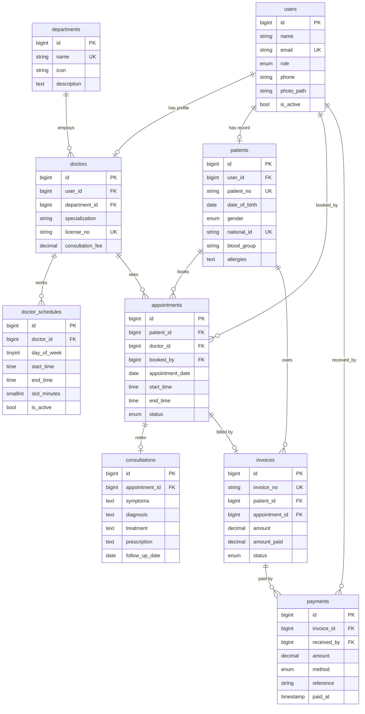

**Enums:** roles (`admin`, `receptionist`, `doctor`, `cashier`, `patient`) · appointment status
(`scheduled`, `checked_in`, `completed`, `cancelled`, `no_show`) · invoice status (`unpaid`, `partial`, `paid`) ·
payment method (`cash`, `mobile_money`, `card`, `insurance`). They are PHP enums in `app/Enums`.

**Key rules**
- A slot is *blocking* when its status is `scheduled`, `checked_in` or `completed`. Cancelled and no-show appointments free the slot.
- Overlap test (half-open intervals): `new.start < existing.end AND new.end > existing.start`.
- `invoices.amount_paid` and `status` are always recalculated from `payments` (`Invoice::refreshTotals()`).

## 10. Seed data

`php artisan migrate:fresh --seed` runs:

| Seeder | Creates |
|---|---|
| `StaffSeeder` | 1 admin, 2 receptionists, 2 cashiers, 1 inactive account (Ugandan names, +256 numbers) |
| `DepartmentSeeder` | 6 departments |
| `DoctorSeeder` | 6 Ugandan doctors (one per department) with UMDPC-style registration numbers, UGX fees and weekly schedules |
| `PatientSeeder` | 10 patients (demo patient + 9 generated Ugandan patients) |
| `ClinicActivitySeeder` | A small, demo-sized history: about 2 months back and 1 week ahead, **~50 appointments** with matching consultations, invoices and payments. The demo doctor always has patients today |
| `Support/Uganda.php` | Helper with Ugandan first names and surnames, MTN/Airtel prefixes, NIN format and Kampala-area addresses |

**Ugandan clinical context.** Visit reasons and notes reflect common local cases: malaria
(mRDT/blood smear, Coartem), typhoid (Widal), peptic ulcer disease, hypertension and diabetes
reviews, UNEPI child immunisation, ANC visits with IPTp, scabies, ringworm, and family planning (Depo-Provera).
Lab charges are in UGX (malaria test 5,000, CBC 20,000, ECG 60,000, scans 40,000–50,000).
Payments are cash, **Mobile Money (MTN/Airtel)** with transaction IDs, card (POS) or insurance claims.
Partial payments are rounded to UGX 500.

The activity seeder builds bookings from each doctor's real schedule slots and tracks doctor and
patient availability, so the seed data contains **no overlapping appointments**. The volume is kept small
so pages stay fast, while the dashboard charts still have data to show.

## 11. Project structure

```
app/
├── Enums/                 Role, AppointmentStatus, InvoiceStatus, PaymentMethod
├── Exports/ReportExport   one generic Excel/CSV export for all reports
├── Http/
│   ├── Controllers/       Dashboard, User, Department, Doctor, DoctorSchedule, Patient,
│   │   │                  Appointment, Consultation, Invoice, Payment, Report, Profile
│   │   └── Ajax/          SlotController
│   └── Middleware/        EnsureUserHasRole (`role:`), EnsureAccountIsActive
├── Models/                User, Department, Doctor, DoctorSchedule, Patient, Appointment,
│                          Consultation, Invoice, Payment (visibleTo scopes for role-based data)
├── Policies/              Appointment, Patient, Consultation, Invoice
├── Services/              AppointmentService (anti-double-booking), InvoiceService
└── helpers.php            money()
database/
├── migrations/            schema above
└── seeders/               Staff, Department, Doctor, Patient, ClinicActivity
resources/
├── js/                    app.js, charts.js, slot-picker.js
├── css/app.css            Bootstrap + Font Awesome + theme
└── views/
    ├── layouts/           app (sidebar + topbar), guest
    ├── components/        stat-card, chart-card, input, select, textarea,
    │                      patient-picker, status-badge, delete-button, page-header, empty
    ├── dashboard/         admin, receptionist, doctor, cashier, patient
    └── …                  one folder per module (index / form / show) + reports/pdf, invoices/pdf
routes/web.php             routes grouped by role
```

## 12. Troubleshooting

| Symptom | Fix |
|---|---|
| Pages take several seconds | Enable OPcache (see [Installation](#3-installation)) or use `composer serve-fast` |
| `SQLSTATE[HY000] [2002] Connection refused` | Start MySQL in the XAMPP control panel and check `DB_*` in `.env` |
| Unstyled pages / `Vite manifest not found` | Run `npm run build` (or keep `npm run dev` running) |
| Profile photos don't show | Run `php artisan storage:link` |
| Dashboards look empty "today" | The seed is relative to the day it ran, so run `php artisan migrate:fresh --seed` again |
| Changed `.env` but nothing happens | `php artisan optimize:clear` |
